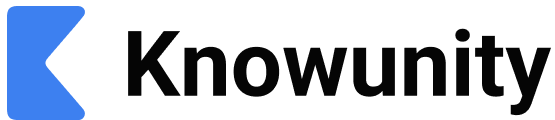

# Startup Growth

Before the studio was code, it was me. Hand-edited study content grew a personal account to over 200M views, then EdTech startups from pre-seed to Series A retained me to audit their organic strategy, train in-house brand teams, and recruit and manage creators for large-scale UGC campaigns. Relatide, an AI retention-calls product, won the Entain × UQIES Weekend of Startups Hackathon in 2025.

Worked with

Thetawise

  

    400M+
    Views
  

  

    260K
    Followers
  

  

    14
    Startups
  

  

    26/day
    Peak Posting Rate
  

