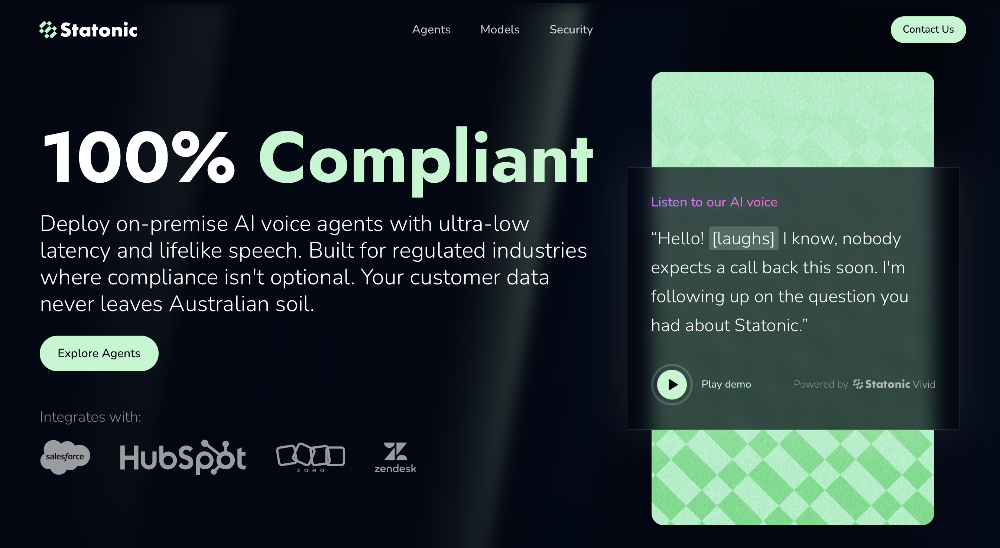
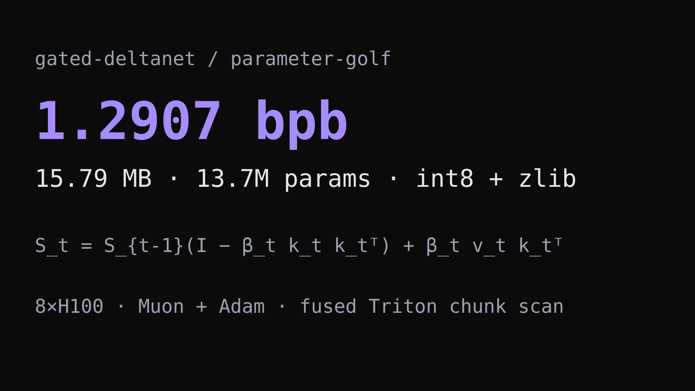
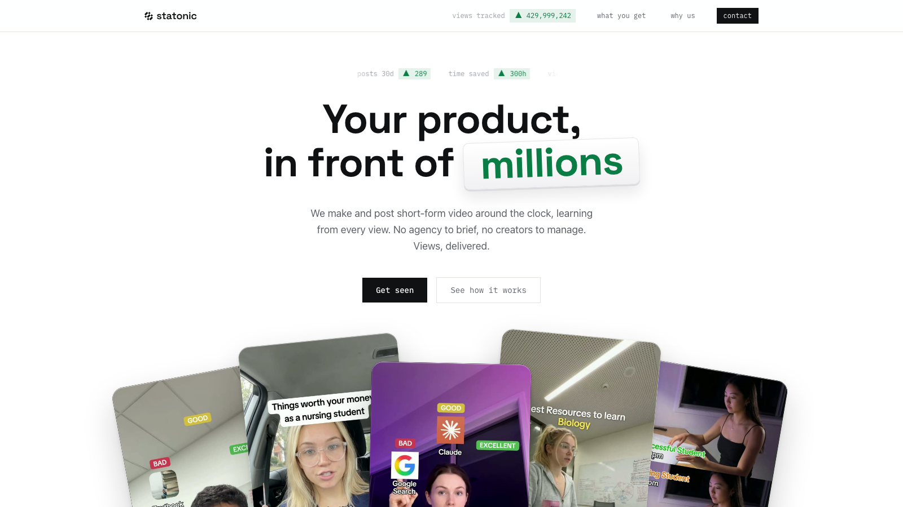
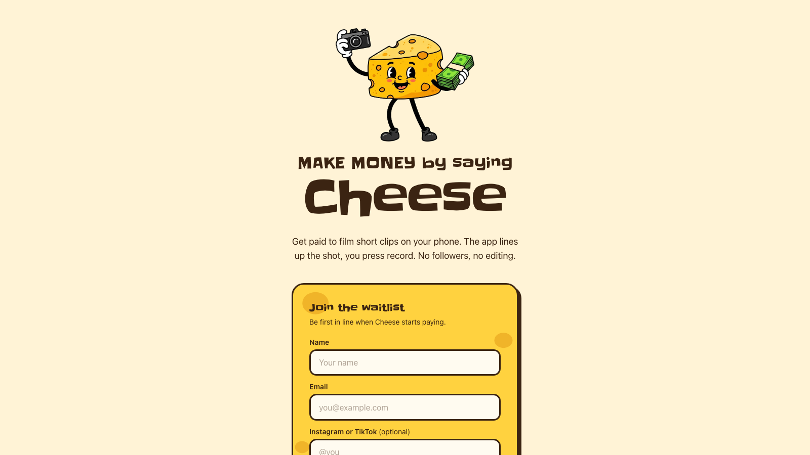
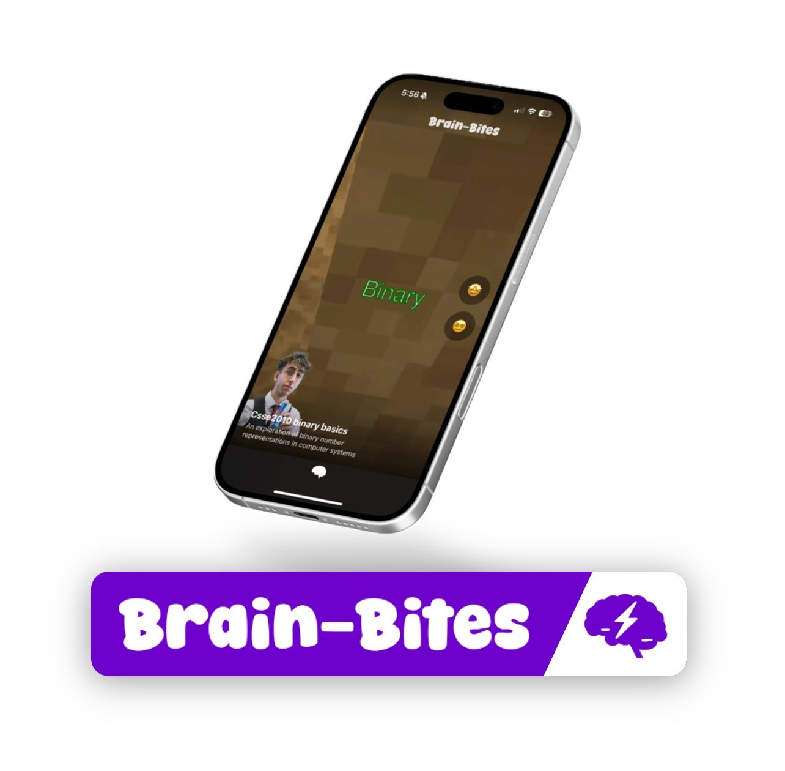

# Projects

<h3>Real-Time Voice Agent TTS Pipeline</h3>

Inference
GPU
AI

Streaming text-to-speech for a conversational voice agent, measured at P50 TTFT 80 ms and P90 180 ms under load on an AWS A10G. TensorRT FP16 engine for the CosyVoice flow-matching estimator, diffusion step reduction tuned for 8 kHz telephony, and asynchronous chunk scheduling so the first audio packet leaves before synthesis finishes. Precursor venture to Statonic; accepted into the UQ Ventures iLab accelerator with $15k pre-seed.

<a href="https://www.linkedin.com/posts/statonic_australian-voices-australian-servers-activity-7402220030916239360-reHd" target="_blank">Demo</a>

<h3>Gated DeltaNet Language Model</h3>

Machine Learning
8×H100
Triton

13.7M-parameter selective state-space language model that replaces attention with a delta-rule update; chunk-parallel scan via fused Triton kernels from flash-linear-attention. Trained on 8×H100 with Muon on 2D weights and Adam on delta-rule parameters: 1.2907 bits per byte at 15.79 MB after int8 quantisation and zlib, submitted to OpenAI's Parameter Golf under its 16 MB budget.

<a href="https://github.com/dnldsz/parameter-golf" target="_blank">GitHub</a>

<h3>Statonic</h3>

Agents
GPU Infra
Video

One-operator content studio run as code. A nightly agent plans each batch off live data, renders, captions, validates against a written posting policy and queues it; I veto from my phone. A dedicated GPU pod handles CUDA Whisper transcription, face-tracked reframing and NVENC encoding behind a pinned release registry, and a split-authority store keeps laptop and VPS coherent with no database. Since the July 2026 launch: 969 posts, 40M views, $200k annualised run-rate, posting up to 26 a day. 400M+ career views.

<a href="https://statonic.com" target="_blank">Live Site</a>

<h3>Cheese</h3>

iOS
Video
AI

Get paid to film short clips on your phone: an overlay-guided filming app lines up the shot, a validator (Vision face tracking, FFmpeg signal stats, whisper.cpp against the script) accepts or rejects each take, and accepted clips land straight in a production pipeline. Built and pitched in a weekend.

Swyftx × UQIES Weekend of Startups Hackathon 2026 — 1st Place

<a href="https://joincheese.com" target="_blank">Live Site</a>

<h3>Brain-Bites</h3>

Mobile
Cloud Infrastructure
AI

AI pipeline that turns course material into short-form learning videos and flashcards, built end to end in 48 hours. I led the team and built the Blackboard LMS integration over the Model Context Protocol.

UQ Computing Society Hackathon 2025 — 1st Place

<a href="https://github.com/s4raaga/brain-bites" target="_blank">GitHub</a>

